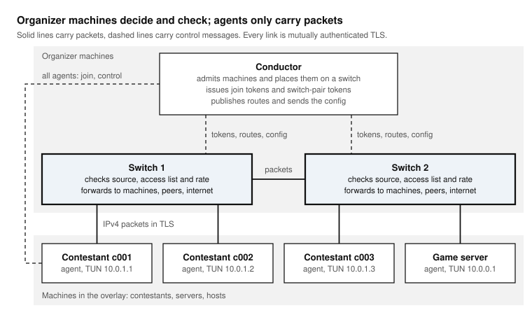

Architecture
============

vNet has three programs. Each runs as its own process, usually as a
systemd service, and they talk to each other over TCP, with TLS on every
link.

   Organizer machines decide and check; agents only carry packets.

The conductor
-------------

One per event, on an organizer machine. It is the control plane:

* it admits switches and agents, checking each name and key against the
  auth file (:doc:`../reference/auth-file`);
* it places each agent on a switch, round-robin among the switches that are
  up, and gives the agent and the switch a one-time token for that join;
* it tells every switch where every agent is, so packets can be forwarded
  directly between switches;
* it holds the access list (:doc:`../reference/switch-config`) and sends it
  to every switch.

The conductor never forwards a packet. When it is down, machines already
connected keep their data path; only joins wait for it.

The switches
------------

One or more, on organizer machines. They are the data plane. Each switch:

* accepts the agents the conductor sends to it;
* checks every packet an agent sends: the source address must be the
  agent's own, the destination must be allowed by the access list, and the
  agent must be within its rate limit;
* delivers the packet to a local agent, forwards it to the switch that
  holds the destination, or sends it to the internet through its own uplink
  with address translation;
* checks again every packet received from another switch, so a faulty peer
  cannot reach a machine the rules do not allow.

The packet engine of a switch is called the *BlackBox* in the code.

The agents
----------

One per machine in the overlay: contestant machines, the contest server,
anything that must take part. An agent:

* joins through the conductor and authenticates to its switch;
* opens a TUN interface, ``vnet-<name>``, with its virtual address, and by
  default makes it the machine's default route, so every IPv4 packet goes
  through the switch;
* keeps the routes to the conductor and to its switch on the physical
  network, plus what the bypass file lists;
* with lockdown on, installs a host firewall that blocks the physical
  network around the overlay (:doc:`../guides/vdi-lockdown`).

An agent makes no decision about packets. Whatever its machine sends, the
switch decides.

Addresses
---------

Every agent has a *virtual address*, assigned in the access list, inside
the *overlay prefix* (``10.0.0.0/8`` unless ``VNET_OVERLAY_CIDR`` says
otherwise). Organizer machines keep their physical addresses, which must
not fall inside the overlay prefix.

A switch also has a TUN interface, ``vnet-out``, at ``192.0.2.1/32``, through
which allowed internet traffic leaves with address translation on the
switch's own default route.

Networks
--------

Each process announces a *network* name when it registers
(``VNET_NETWORK``). Agents announce ``vnet.internal`` and switches
``::internet`` by default. The conductor places an agent on a switch of the
same network or of ``::internet``. With the defaults, any agent may go to
any switch; distinct networks pin a group of machines to a group of
switches, for instance one switch per room.

Ports and links
---------------

.. list-table::
   :header-rows: 1
   :widths: 30 20 50

   * - Link
     - Port
     - Carries
   * - agent to conductor
     - 5000 (``CONDUCTOR_PORT``)
     - joins, heartbeats, reconnection
   * - switch to conductor
     - 5000
     - registration, tokens, routes, the access list
   * - agent to switch
     - the switch's port (6000, ...)
     - the agent's packets
   * - switch to switch
     - the switch's port
     - packets between machines on different switches

Every link is one TCP connection carrying framed messages
(:doc:`../reference/protocol`). Packets between agents ride inside these
links: the overlay is IPv4 over TLS over TCP.
