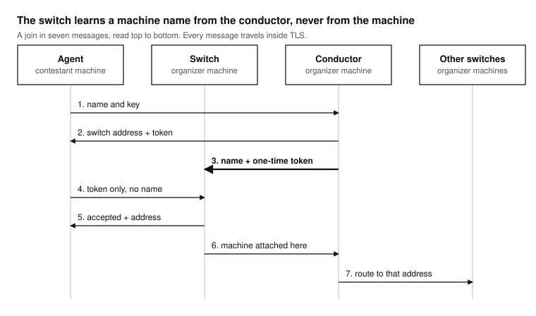

How a machine joins
===================

A machine joins in seven messages. The order is chosen so that a switch
never learns a machine's identity from the machine itself.

   The switch learns a machine name from the conductor, never from the
   machine.

1. The agent connects to the conductor and sends its name and key
   (``AGENT_MIP``).
2. The conductor checks them against the auth file, picks a switch, and
   sends the agent the switch's address and a random 64-bit token
   (``CONNECT_TO_SWITCH``).
3. The conductor sends the same token to the switch, with the agent's name
   (``AGENT_CONNECTION_TOKEN``). The token is valid once, for 60 seconds.
4. The agent connects to the switch and presents the token, and nothing
   else (``AUTH_CONNECT_TO_SWITCH``).
5. The switch finds the name that goes with the token, looks up that name's
   virtual address in the access list, and answers with the address
   (``CONNECTION_ACCEPTED``). The agent opens its TUN with it.
6. The switch tells the conductor the machine is attached
   (``AGENT_REGISTERED``).
7. The conductor tells every other switch where that address now lives
   (``SWITCH_ROUTE_UPDATE``).

Why it works this way
---------------------

A contestant machine is not trusted. If an agent told its switch who it
is, a machine with a stolen or modified agent could claim another
machine's name, and with it another machine's rules. Here the machine
proves its identity once, to the conductor, with its key and its TLS
certificate; the switch only matches a token the conductor gave it. The
switch then binds the connection to that name's address, and drops every
packet whose source address is not that one.

Both links of the agent stay open. The switch link carries packets; the
conductor link carries heartbeats and lets the agent rejoin quickly.

What the agent does after joining
---------------------------------

* It brings up ``vnet-<name>`` with its virtual address and a route to the
  overlay prefix.
* It pins ``/32`` routes to the conductor and to its switch through the
  previous gateway, and the ``route`` prefixes of its bypass file, so these
  stay on the physical network.
* Unless ``VNET_DEFAULT_VIA_TUN=0``, it replaces the default route with the
  TUN. The previous route is saved in ``/run/vnet/agent-<name>.route`` so
  that it can be put back even after a crash.
* With ``VNET_LOCKDOWN=1``, it installs its firewall chains.

When it stops, the agent puts the default route back, removes its pins and
its firewall chains.

Failed joins
------------

The agent learns little when a join fails: the conductor does not explain
a refusal to a machine it does not trust. The agent prints
``No switch assignment from the conductor (rejected, no switch available,
or no answer)`` and tries again two seconds later; the reason is in the
conductor's log. :doc:`../troubleshooting` lists the cases.
